# MAL Reviewer showcase

A tour of MAL Reviewer in screenshots. The account shown, *ReviewerDemo*, is made up; the searches, covers and details are real.

## Dashboard
Load any public MyAnimeList account to see its profile, Anime and Manga statistics, and favorites.

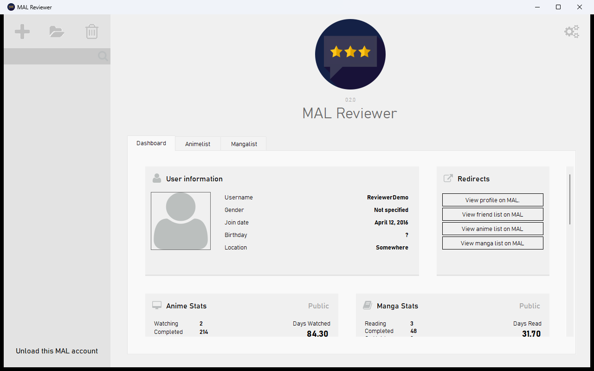

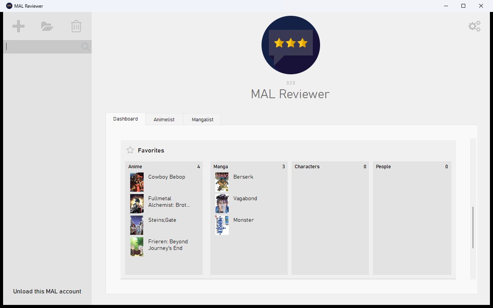

## Anime and Manga lists
The lists of the account, split by status, with the progress and score of each entry.

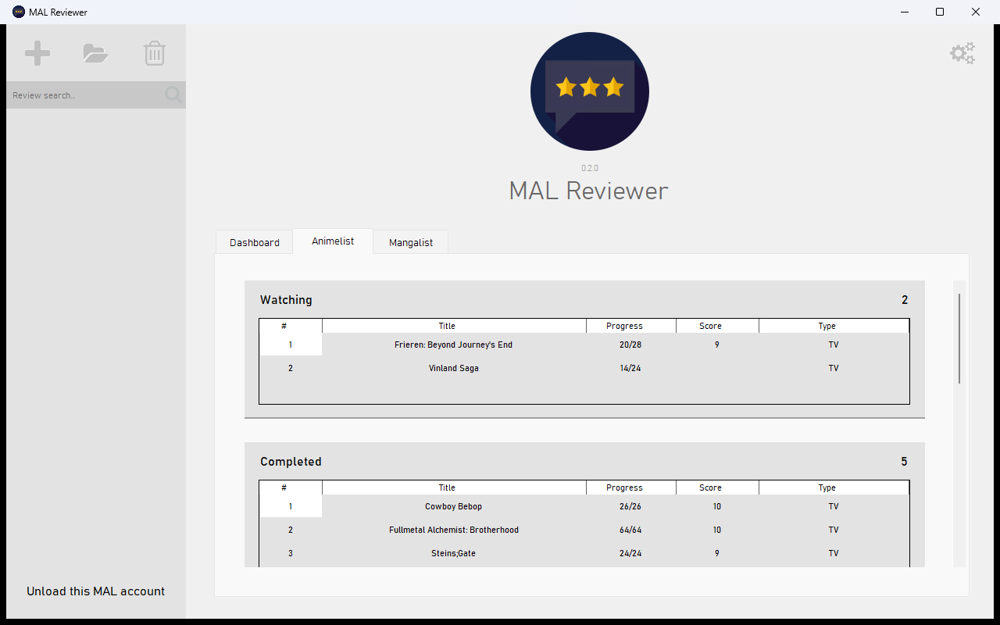

## Themes
Same as Windows (the default), light, dark, or your own colors.

| Dark | Custom colors |
| --- | --- |
| 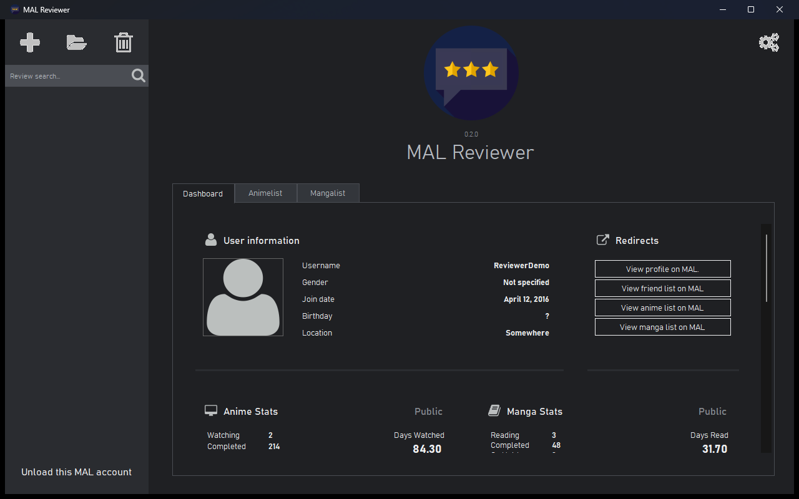 | 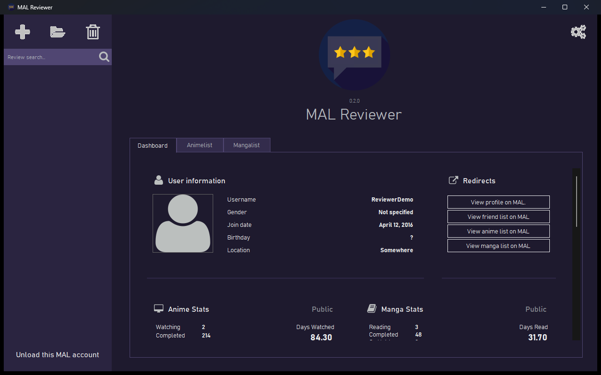 |

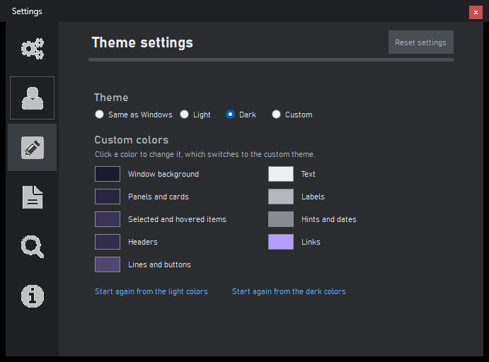

## Writing a review
Search an Anime or a Manga by title, or paste its MyAnimeList link, then preview it before picking a review template.

| Search | Preview |
| --- | --- |
| 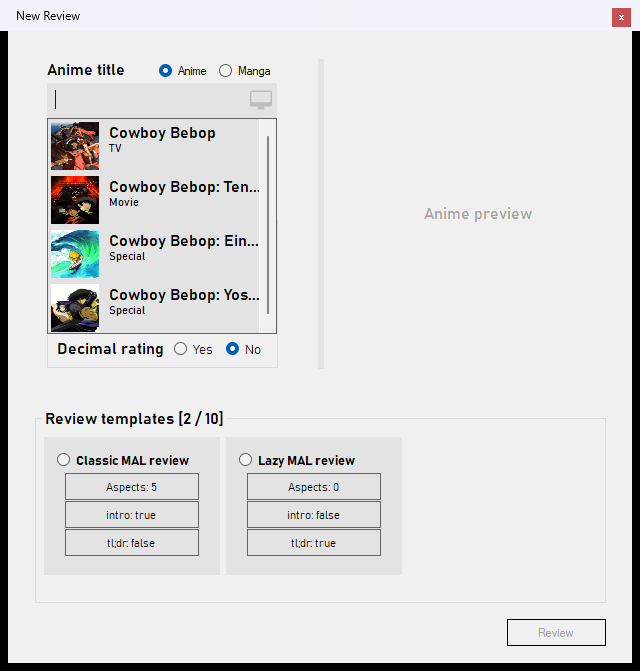 | 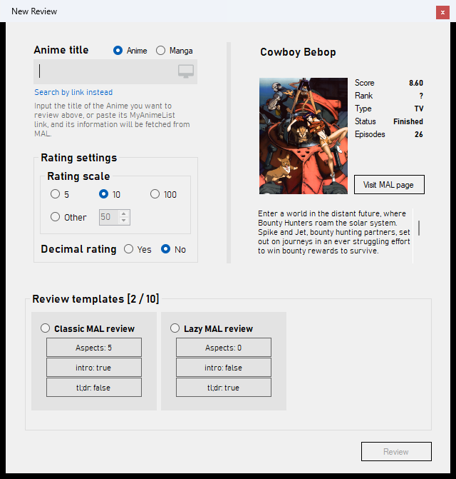 |

## Loading an account
The users loaded recently are listed under the username box, to load them again with a click.

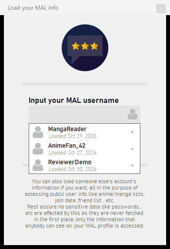

## Settings
| Search | Review templates |
| --- | --- |
| 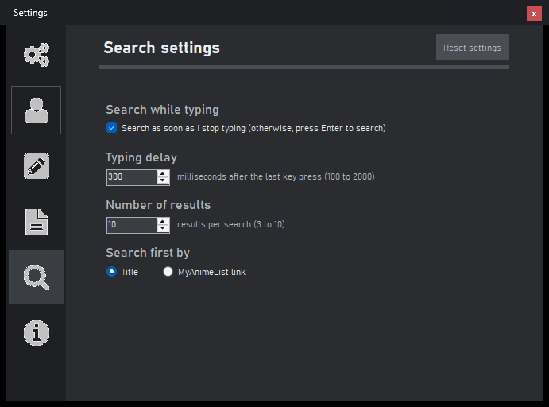 | 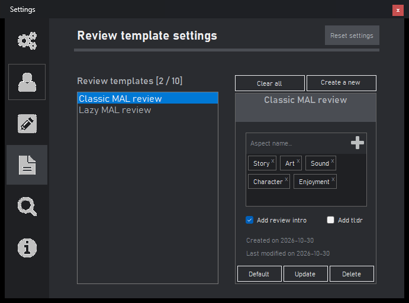 |

| User | Export and import |
| --- | --- |
| 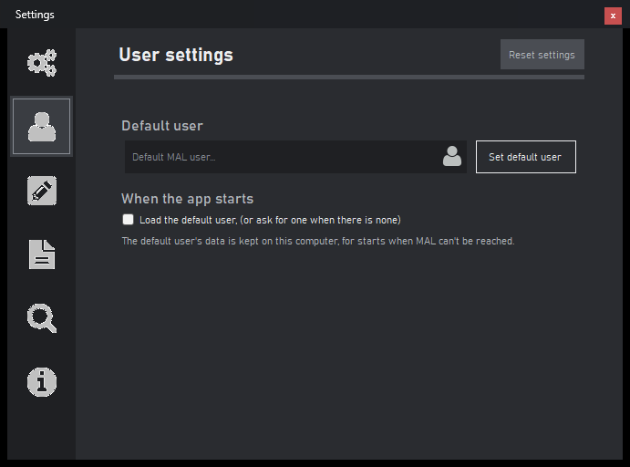 | 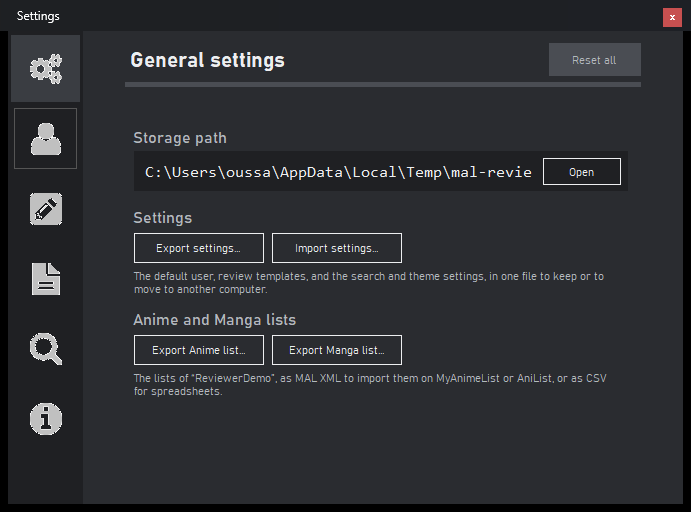 |
